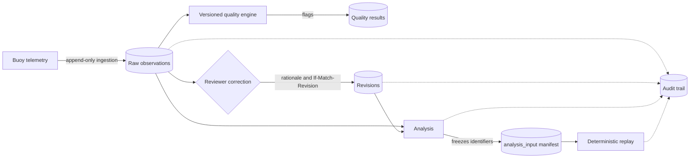

# TideTrace

**Provenance-Aware Ocean Data Integrity and Anomaly Investigation System**

[](https://www.postgresql.org/)
[](https://fastapi.tiangolo.com/)
[](https://vitejs.dev/)
[](#7-verification-and-testing)
[](#8-performance-benchmarking)

---

## Contents

1. [Overview](#1-overview)
2. [System Architecture](#2-system-architecture)
3. [Technology Stack](#3-technology-stack)
4. [Installation and Configuration](#4-installation-and-configuration)
5. [Running the Application](#5-running-the-application)
6. [Provenance and Replay Demonstration](#6-provenance-and-replay-demonstration)
7. [Verification and Testing](#7-verification-and-testing)
8. [Performance Benchmarking](#8-performance-benchmarking)
9. [User Roles and Access Control](#9-user-roles-and-access-control)
10. [Repository Structure](#10-repository-structure)

---

## 1. Overview

TideTrace is a scientific oceanographic database management and anomaly investigation system. It is designed to preserve the integrity of buoy-collected telemetry throughout its lifecycle, including ingestion, quality control, scientific correction, analysis, and audit.

Oceanographic datasets are routinely corrected after collection owing to sensor drift, outlier detection, and recalibration. Where such corrections overwrite prior values, previously published results can no longer be reproduced. TideTrace addresses this problem by treating raw telemetry as immutable evidence, scientific corrections as reviewed and attributed events, and every analysis as a frozen, replayable snapshot.

**Core guarantee:** an analysis executed prior to a data correction will, when replayed after that correction, return exactly the original result.

---

## 2. System Architecture

### 2.1 Design Principles

| No. | Principle | Description |
|---|---|---|
| 1 | Raw telemetry immutability | Sensor observations ingested from buoys are strictly append-only. Automated quality tests and scientific corrections never mutate or overwrite raw telemetry. |
| 2 | Versioned quality engine | Rules governing physical range, temporal gaps, rate of change, stuck sensors, and duplicates are explicitly versioned (`v1.0`, `v1.1`), ensuring historical auditability. |
| 3 | Concurrency-safe revisions | Scientific corrections require human review, a mandatory rationale of at least five characters, pessimistic row locking (`SELECT ... FOR UPDATE`), and `If-Match-Revision` tokens. A stale revision token results in HTTP 409. |
| 4 | Frozen analysis manifests | Each analysis records the observation and revision identifiers it consumed in `analysis_input`. Replay queries only the frozen manifest, preserving historical results after subsequent corrections. |
| 5 | Database-first integrity | Integrity is enforced within PostgreSQL through ACID transaction rollback on invalid ingestion records, composite foreign keys `(observation_id, revision_id)`, and check constraints. |

### 2.2 Data Flow



Corrections never modify raw observations. They are recorded as new revisions, and each analysis pins the exact observation and revision versions it used.

---

## 3. Technology Stack

| Layer | Technology |
|---|---|
| Database | PostgreSQL 18.6 (version 16 or later supported); Alembic migrations |
| Backend | Python 3.11+; FastAPI 0.115+; SQLAlchemy with psycopg |
| Frontend | React 19; Vite; TypeScript |
| Testing | pytest (backend); npm test runner (frontend) |

---

## 4. Installation and Configuration

### 4.1 Prerequisites

- **Python:** 3.11 or later
- **Node.js:** v20 or later (v24 with npm 11 verified)
- **PostgreSQL:** 16 or later (developed against 18.6 on port 5433)

### 4.2 Environment Configuration

Create a `.env` file in the project root:

```ini
DATABASE_URL=postgresql+psycopg://postgres:@127.0.0.1:5433/tidetrace
SECRET_KEY=replace-with-a-long-random-value
ACCESS_TOKEN_EXPIRE_MINUTES=120
PROJECT_NAME=TideTrace
API_V1_PREFIX=/api/v1
```

> **Note:** A unique `SECRET_KEY` must be generated for any non-local deployment, for example:
> `python -c "import secrets; print(secrets.token_urlsafe(48))"`

### 4.3 Database Migration and Seeding

```powershell
# 1. Apply Alembic migrations
alembic upgrade head

# 2. Seed base metadata (stations, sensors, deployments, calibrations, users, rules)
python scripts/seed_data.py

# 3. Generate 100,000+ synthetic oceanographic telemetry records (idempotent)
python scripts/generate_100k_dataset.py
```

---

## 5. Running the Application

### 5.1 Backend API Server (FastAPI)

```powershell
uvicorn backend.app.main:app --host 127.0.0.1 --port 8001 --reload
```

| Resource | URL |
|---|---|
| API base URL | `http://localhost:8001/api/v1` |
| Swagger UI documentation | `http://localhost:8001/api/v1/docs` |
| OpenAPI specification | `http://localhost:8001/api/v1/openapi.json` |

### 5.2 Frontend Research Dashboard (React and Vite)

```powershell
cd frontend
npm install
npm run dev
```

The dashboard is available at `http://localhost:5174`.

---

## 6. Provenance and Replay Demonstration

The following script executes a ten-step demonstration of scientific reproducibility:

```powershell
python scripts/demo_provenance_replay.py
```

| Step | Action | Verified Outcome |
|---|---|---|
| 1 | Ingest three raw salinity readings | `[30.0, 32.0, 34.0]` |
| 2 | Create Analysis A (mean, prior to correction) | `mean == 32.000000` |
| 3 | Freeze and inspect the manifest of Analysis A in `analysis_input` | Manifest recorded |
| 4 | An authorized Reviewer corrects Observation 2 | Accepted value becomes `38.0` |
| 5 | Replay Analysis A | Result remains `32.000000`; manifest fully intact |
| 6 | Create Analysis B (post-correction) | `mean == 34.000000` |
| 7 | Replay Analysis B and re-verify Analysis A | B yields `34.000000`; A yields `32.000000` |
| 8 | Inspect audit events | Ingestion, revision, creation, and replay events recorded |
| 9 | Demonstrate access and concurrency controls | HTTP 403 for researcher revision attempt; HTTP 409 for stale `If-Match-Revision` |
| 10 | Summarize PostgreSQL performance metrics and query plan evidence | Metrics reported |

The demonstration shows two analyses over the same data lineage producing distinct results, each of which remains independently reproducible.

---

## 7. Verification and Testing

### 7.1 Backend Regression Suite (40 Tests)

```powershell
python -m pytest backend/tests/ -v
```

**Result:** 40 passed in 1.00 s (100% pass rate).

| Test Module | Coverage |
|---|---|
| `test_concurrency.py` | Prevention of concurrent race conditions under pessimistic locking |
| `test_db_constraints.py` | Database check constraints, coordinate bounds, and immutability |
| `test_ingestion_api.py` | Idempotency keys, atomic batch rollback, and duplicate skipping |
| `test_quality_engine_api.py` | Range, gap, stuck-sensor, and rate-of-change rules |
| `test_revisions_api.py` | Revision workflow, minimum reason length, role-based access, and stale-revision 409 conflict |
| `test_analysis_replay_api.py` | Manifest freezing, deterministic replay after corrections, and metrics |
| `test_audit_api.py` | Audit trail search, pagination, and role-based access |

### 7.2 Frontend Test Suite (6 Tests)

```powershell
cd frontend
npm run test
```

**Result:** 6 passed in 1.27 s (100% pass rate).

---

## 8. Performance Benchmarking

The automated PostgreSQL benchmarking harness operates over 100,000+ rows. Each query is measured over 50 repetitions.

```powershell
python scripts/benchmark_suite.py
```

The generated report is available at [`docs/benchmarks.md`](docs/benchmarks.md).

| Query Scenario | Median (ms) | p95 (ms) | Plan Scan Type | PostgreSQL Buffers |
|---|---|---|---|---|
| Q1: Sensor and time range | 0.235 | 0.292 | Index Scan (`idx_observation_sensor_time`) | 100% shared hit |
| Q2: Parameter and time range | 0.328 | 0.517 | Bitmap Index Scan (`idx_observation_parameter_time`) | 100% shared hit |
| Q3: Quality flag lookup | 0.155 | 0.224 | Index Scan (`idx_quality_result_observation_tested`) | 100% shared hit |
| Q4: Revision history | 0.132 | 0.234 | Seq Scan (74 rows; optimizer prefers in-cache read) | 100% shared hit |
| Q5: Frozen manifest retrieval | 0.117 | 0.219 | Index Scan (composite primary key) | 100% shared hit |
| Q6: Audit event search | 0.249 | 0.339 | Seq Scan (187 rows; top-N heapsort) | 100% shared hit |
| Q7: Replay input resolution join | 0.233 | 0.361 | Index Scan (nested loop on composite foreign key) | 100% shared hit |

All seven query scenarios resolve in under one millisecond at the median. The two sequential scans (Q4 and Q6) reflect planner selection on small tables and do not indicate missing indexes.

---

## 9. User Roles and Access Control

Role-based access control is enforced at the API layer.

| Username | Role | Permitted Actions |
|---|---|---|
| `admin_clara` | Administrator | Full access: rule creation, revisions, analyses, audit search |
| `steward_bob` | Data Steward | Ingestion batch intake, quality rule configuration, revisions |
| `reviewer_alice` | Reviewer | Observation review, measurement revisions, quality assessments |
| `researcher_sam` | Researcher | Read-only observations, analysis creation, deterministic replay |

The accounts above are seeded for local development and demonstration only. They must be replaced or removed prior to any production deployment.

---

## 10. Repository Structure

```text
tidetrace/
├── alembic/                  # Database schema migrations
├── backend/
│   ├── app/main.py           # FastAPI application entry point
│   └── tests/                # Backend regression suite (40 tests)
├── frontend/                 # React 19, Vite, and TypeScript dashboard
├── scripts/
│   ├── seed_data.py
│   ├── generate_100k_dataset.py
│   ├── benchmark_suite.py
│   └── demo_provenance_replay.py
└── docs/
    └── benchmarks.md         # Generated benchmark report
```
