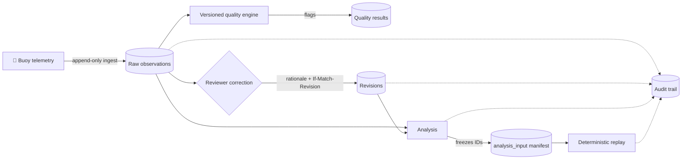

<div align="center">

# 🌊 TideTrace

### Provenance-aware ocean data integrity & anomaly investigation

**Every reading preserved. Every correction justified. Every analysis reproducible.**

[](https://www.postgresql.org/)
[](https://fastapi.tiangolo.com/)
[](https://vitejs.dev/)
[](#-testing)
[](#-performance)

[Why TideTrace](#-why-tidetrace) · [Architecture](#-architecture) · [Quick Start](#-quick-start) · [Replay Demo](#-the-replay-demo) · [Performance](#-performance) · [Roles](#-roles--access)

</div>

---

## 💡 Why TideTrace

Oceanographic datasets get corrected over time: sensors drift, outliers are flagged, calibrations change. The danger is that a correction silently rewrites history, and a result someone published last month can no longer be reproduced.

TideTrace removes that failure mode. It treats raw telemetry as evidence, corrections as reviewed and attributed events, and every analysis as a frozen, replayable snapshot.

> **The core guarantee:** run an analysis today, correct the underlying data tomorrow, and replaying the original analysis still returns the *exact* original result.

---

## 🏛 Architecture

### Five design pillars

| # | Pillar | What it guarantees |
|---|---|---|
| 1 | **Raw telemetry immutability** | Buoy observations are append-only. QC tests and scientific corrections never mutate or overwrite raw data. |
| 2 | **Versioned quality engine** | Rules for physical range, temporal gaps, rate of change, stuck sensors, and duplicates are explicitly versioned (`v1.0`, `v1.1`) for historical auditability. |
| 3 | **Concurrency-safe revisions** | Corrections need human review, a mandatory rationale (≥ 5 chars), pessimistic row locking (`SELECT … FOR UPDATE`), and `If-Match-Revision` tokens. Stale writes get **HTTP 409**. |
| 4 | **Frozen analysis manifests** | Each analysis freezes the observation and revision IDs it consumed into `analysis_input`. Replay reads *only* the manifest. |
| 5 | **Database-first integrity** | ACID rollback on invalid ingestion, composite foreign keys `(observation_id, revision_id)`, and check constraints enforced in PostgreSQL itself. |

### Data flow



Corrections never touch `Raw observations`. They land as new revisions, and analyses pin exactly which observation and revision versions they used.

---

## 🧰 Tech Stack

| Layer | Technology |
|---|---|
| Database | PostgreSQL 18.6 (16+ supported), Alembic migrations |
| Backend | Python 3.11+, FastAPI 0.115+, SQLAlchemy + psycopg |
| Frontend | React 19, Vite, TypeScript |
| Testing | pytest (backend), npm test runner (frontend) |

---

## 🚀 Quick Start

### Prerequisites

- **Python** 3.11+
- **Node.js** v20+ (v24 / npm 11 verified)
- **PostgreSQL** 16+ (developed against 18.6 on port `5433`)

### 1. Configure the environment

Create a `.env` in the project root:

```ini
DATABASE_URL=postgresql+psycopg://postgres:@127.0.0.1:5433/tidetrace
SECRET_KEY=change-me-use-a-long-random-value
ACCESS_TOKEN_EXPIRE_MINUTES=120
PROJECT_NAME=TideTrace
API_V1_PREFIX=/api/v1
```

> ⚠️ Generate a unique `SECRET_KEY` for any non-local deployment, e.g. `python -c "import secrets; print(secrets.token_urlsafe(48))"`.

### 2. Migrate and seed

```powershell
# Apply schema migrations
alembic upgrade head

# Seed stations, sensors, deployments, calibrations, users, and QC rules
python scripts/seed_data.py

# Generate 100,000+ synthetic telemetry records (idempotent)
python scripts/generate_100k_dataset.py
```

### 3. Run the backend

```powershell
uvicorn backend.app.main:app --host 127.0.0.1 --port 8001 --reload
```

| Resource | URL |
|---|---|
| API base | `http://localhost:8001/api/v1` |
| Swagger UI | `http://localhost:8001/api/v1/docs` |
| OpenAPI spec | `http://localhost:8001/api/v1/openapi.json` |

### 4. Run the dashboard

```powershell
cd frontend
npm install
npm run dev
```

Open **http://localhost:5174**.

---

## 🔬 The Replay Demo

One script proves the central claim end to end:

```powershell
python scripts/demo_provenance_replay.py
```

**The story it tells:**

| Step | Event | Result |
|---|---|---|
| 1 | Ingest three raw salinity readings | `[30.0, 32.0, 34.0]` |
| 2 | Create **Analysis A** (mean) | `32.000000` ✅ |
| 3 | Inspect Analysis A's frozen manifest in `analysis_input` | Manifest recorded |
| 4 | Reviewer corrects Observation 2 | Accepted value becomes `38.0` |
| 5 | **Replay Analysis A** | Still `32.000000`, manifest 100% intact ✅ |
| 6 | Create **Analysis B** post-correction | `34.000000` ✅ |
| 7 | Replay B, then re-verify A | B → `34.000000`, A → `32.000000` ✅ |
| 8 | Inspect audit events | Ingestion, revision, creation, and replay all logged |
| 9 | Test guardrails | `403` for researcher revision attempt, `409` for stale `If-Match-Revision` |
| 10 | Summarize PostgreSQL metrics and query plans | Evidence printed |

Two analyses over the same data lineage, two different answers, both reproducible forever.

---

## ✅ Testing

### Backend: 40 tests

```powershell
python -m pytest backend/tests/ -v
```

| Suite | Covers |
|---|---|
| `test_concurrency.py` | Race-condition prevention under pessimistic locking |
| `test_db_constraints.py` | Check constraints, coordinate bounds, immutability |
| `test_ingestion_api.py` | Idempotency keys, atomic batch rollback, duplicate skipping |
| `test_quality_engine_api.py` | Range, gap, stuck-sensor, and rate-of-change rules |
| `test_revisions_api.py` | Revision workflow, minimum reason length, RBAC, stale `409` |
| `test_analysis_replay_api.py` | Manifest freezing, deterministic replay after corrections, metrics |
| `test_audit_api.py` | Audit search, pagination, RBAC |

### Frontend: 6 tests

```powershell
cd frontend
npm run test
```

**Latest run:** 40 backend + 6 frontend, all passing.

---

## ⚡ Performance

Benchmarked on **100,000+ rows** in PostgreSQL, 50 repetitions per query:

```powershell
python scripts/benchmark_suite.py
```

Full report: [`docs/benchmarks.md`](docs/benchmarks.md)

| Query | Median | p95 | Plan | Buffers |
|---|---|---|---|---|
| **Q1** Sensor + time range | 0.235 ms | 0.292 ms | Index Scan · `idx_observation_sensor_time` | 100% shared hit |
| **Q2** Parameter + time range | 0.328 ms | 0.517 ms | Bitmap Index Scan · `idx_observation_parameter_time` | 100% shared hit |
| **Q3** Quality flag lookup | 0.155 ms | 0.224 ms | Index Scan · `idx_quality_result_observation_tested` | 100% shared hit |
| **Q4** Revision history | 0.132 ms | 0.234 ms | Seq Scan (74 rows; planner prefers cached read) | 100% shared hit |
| **Q5** Frozen manifest retrieval | 0.117 ms | 0.219 ms | Index Scan · composite primary key | 100% shared hit |
| **Q6** Audit event search | 0.249 ms | 0.339 ms | Seq Scan (187 rows, top-N heapsort) | 100% shared hit |
| **Q7** Replay input resolution join | 0.233 ms | 0.361 ms | Index Scan · nested loop on composite FK | 100% shared hit |

All seven queries resolve in well under a millisecond at the median. The two sequential scans (Q4, Q6) are deliberate planner choices on tiny tables, not missing indexes.

---

## 👥 Roles & Access

Role-based access control is enforced at the API layer.

| Account | Role | Can do |
|---|---|---|
| `admin_clara` | Administrator | Everything: rule creation, revisions, analyses, audit search |
| `steward_bob` | Data Steward | Ingestion batches, quality rule configuration, revisions |
| `reviewer_alice` | Reviewer | Observation review, measurement revisions, quality assessments |
| `researcher_sam` | Researcher | Read observations, create analyses, run deterministic replay |

These are seeded demo accounts for local development. Replace them before any real deployment.

---

## 🗂 Repository Layout

```text
tidetrace/
├── alembic/                  # Schema migrations
├── backend/
│   ├── app/main.py           # FastAPI entrypoint
│   └── tests/                # 40 regression tests
├── frontend/                 # React 19 + Vite + TypeScript dashboard
├── scripts/
│   ├── seed_data.py
│   ├── generate_100k_dataset.py
│   ├── benchmark_suite.py
│   └── demo_provenance_replay.py
└── docs/benchmarks.md        # Generated benchmark report
```

---

<div align="center">

**TideTrace**: because science should be able to show its work.

</div>
