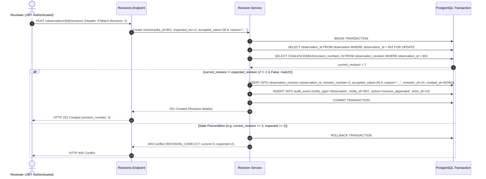
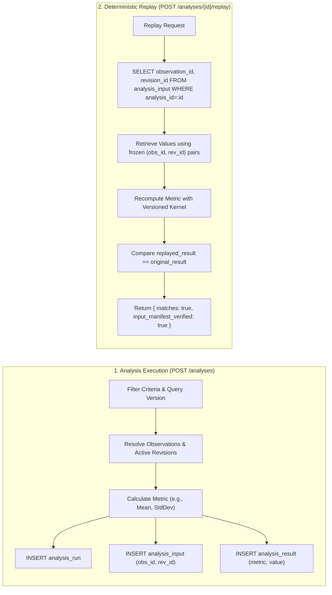

# TideTrace: System Architecture Specification

**Document Version:** 1.0.0  
**Project:** TideTrace — Provenance-Aware Ocean Data Integrity and Anomaly Investigation System  
**Status:** Approved Architectural Baseline  

---

## 1. System Overview & Core Principles

TideTrace is an advanced, database-centered system designed to ingest, validate, curate, and analyze oceanographic time-series observations while guaranteeing complete provenance and scientific reproducibility. 

### Core Architectural Pillars
1. **Raw Observation Immutability:** Raw sensor measurements are append-only. No analytical process, automated check, or human correction can ever alter or delete an existing `observation` row.
2. **Versioned Quality Control:** Quality control rules are treated as immutable, versioned domain entities. Test results link specific observations to explicit rule versions.
3. **Curated Append-Only Revisions:** Discrepancies are addressed by appending a new revision record linked to the original observation, requiring verified reviewer attribution, decision justification (>= 5 chars), and optional calibration linkage.
4. **Deterministic Analysis Manifests:** Every analytical aggregation freezes a manifest containing the exact observation IDs and revision IDs utilized. Replay computations execute against the frozen manifest rather than dynamic live state.
5. **Database-First Integrity:** Relational constraints (composite unique keys, domain check constraints, foreign keys, row-level locks) form the primary line of defense against data corruption.

---

## 2. Component Architecture

The TideTrace system follows a clean, layered architectural pattern with clear separation of concerns across ingestion, domain curation, analysis engine, persistence, and presentation.

```mermaid
graph TD
    subgraph ClientLayer["Presentation Layer (Vite + React)"]
        UI_Explorer["Screen 1: Data Explorer<br/>(Stations, Sensors, Telemetry)"]
        UI_Quality["Screen 2: Quality Investigation<br/>(Rules, Flags, Append Revisions)"]
        UI_Lab["Screen 3: Reproducibility Lab<br/>(Analysis Manifests, Replay, Benchmarks)"]
    end

    subgraph APILayer["API Gateway & Application Server (FastAPI)"]
        AuthMiddleware["JWT Bearer Authentication & RBAC Filter"]
        ReqIdMiddleware["Request ID & Structured Logging Middleware"]
        
        subgraph Endpoints["REST API Controllers (/api/v1)"]
            EP_Auth["/auth/token"]
            EP_Reg["/stations, /sensors"]
            EP_Ingest["/ingestion/batches"]
            EP_Obs["/observations"]
            EP_QC["/quality-rules, /quality-tests"]
            EP_Rev["/observations/{id}/revisions"]
            EP_Analysis["/analyses, /analyses/{id}/replay"]
            EP_Audit["/audit-events"]
        end

        subgraph CoreServices["Domain Service Layer"]
            Svc_Ingest["Ingestion & Idempotency Service"]
            Svc_QC["Quality Control Engine"]
            Svc_Rev["Revision & Concurrency Service"]
            Svc_Analysis["Analysis Execution & Manifest Engine"]
            Svc_Audit["Audit Logging Service"]
        end
    end

    subgraph DBLayer["Relational Persistence Layer (PostgreSQL 16+)"]
        T_Idemp["idempotency_key"]
        T_Reg["research_station, sensor, sensor_deployment, calibration"]
        T_Obs["observation (Immutable Telemetry)"]
        T_QC["quality_rule, quality_test_result"]
        T_Rev["observation_revision (Append-Only)"]
        T_Analysis["analysis_run, analysis_input, analysis_result"]
        T_Audit["audit_event"]
    end

    ClientLayer -->|HTTPS / JSON + Bearer JWT| AuthMiddleware
    AuthMiddleware --> ReqIdMiddleware
    ReqIdMiddleware --> Endpoints
    Endpoints --> CoreServices
    CoreServices -->|SQLAlchemy 2.0 / Parameterized SQL| DBLayer
```



---

## 3. Technology Stack & Component Responsibilities

| Technology | Role | Version / Configuration | Key Architectural Justification |
|---|---|---|---|
| **PostgreSQL** | Relational Database Engine | 16+ | Native row-level locking (`FOR UPDATE`), composite foreign keys, partial indexes, deterministic transaction isolation, and rich execution profiling via `EXPLAIN (ANALYZE, BUFFERS)`. |
| **Python** | Backend Runtime | 3.11+ | Strong typing support, robust scientific computing libraries, and high-performance asynchronous I/O. |
| **FastAPI** | REST API Framework | 0.110+ | Native OpenAPI 3.1 generation, dependency injection for RBAC/sessions, high-throughput asynchronous request handling. |
| **SQLAlchemy** | Persistence / ORM & Core | 2.0+ | Modern 2.0 syntax, type-safe queries, explicit session management, parameterized query compilation preventing SQL injection. |
| **Alembic** | Schema Migration Tool | 1.13+ | Version-controlled, deterministic relational migrations supporting repeatable forward and backward schema evolution. |
| **Pydantic** | Schema Validation | v2.6+ | High-speed Rust-based input validation, strict ISO 8601 UTC timestamp enforcement, automatic error formatting. |
| **PyJWT & Passlib** | Authentication & Security | PyJWT 2.8+, bcrypt 4.1+ | Stateless Bearer JWT tokens, role claims extraction, secure salted password hashing. |
| **React** | User Interface Library | 18+ | Component-based, responsive UI supporting real-time data inspection, drawer modals, and tabular state management. |
| **Vite** | Frontend Build Tooling | 5.0+ | Fast hot-module replacement (HMR), lightweight build output, modern ESM bundling. |
| **Vanilla CSS** | Styling System | Custom CSS Variables | High-performance, zero-overhead modern design system featuring glassmorphism, responsive data grids, and cohesive color schemes. |

---

## 4. Detailed Data Flows & Pipelines

### 4.1 Idempotent & Atomic Ingestion Pipeline

The batch ingestion pipeline processes batches up to 5,000 records, enforcing request-level idempotency and record-level uniqueness.

```mermaid
sequenceDiagram
    autonumber
    actor Client as Ingestion Source / Steward
    participant API as Ingestion Endpoint
    participant Svc as Ingestion Service
    participant DB as PostgreSQL Transaction

    Client->>API: POST /ingestion/batches (Header: Idempotency-Key)
    API->>Svc: Process batch (atomic=true, records=[...])
    Svc->>DB: BEGIN TRANSACTION (ISOLATION LEVEL READ COMMITTED)
    Svc->>DB: SELECT response_payload FROM idempotency_key WHERE key = :key FOR UPDATE
    alt Idempotency Key Already Exists & Succeeded
        DB-->>Svc: Cached response payload
        Svc-->>API: Return cached 201 response
        API-->>Client: HTTP 201 (Idempotent replay)
    else Key in Progress
        Svc-->>API: Conflict: 409 IDEMPOTENCY_IN_PROGRESS
        API-->>Client: HTTP 409 Conflict
    else Fresh Key
        Svc->>DB: INSERT INTO idempotency_key (key, status='processing')
        loop For Each Observation in Batch
            Svc->>DB: Check (source_system, source_message_id) existence
            alt Record already exists in DB
                Svc->>Svc: Increment duplicate_count; skip insert
            else New record
                Svc->>DB: INSERT INTO observation (...)
            end
        end
        alt Error encountered during batch & atomic=true
            Svc->>DB: ROLLBACK TRANSACTION
            Svc-->>API: Validation / DB Error (HTTP 422)
            API-->>Client: HTTP 422 Error (Zero records inserted)
        else All valid records processed
            Svc->>DB: INSERT INTO audit_event (entity_type='batch', action='ingest')
            Svc->>DB: UPDATE idempotency_key SET status='completed', response_payload=...
            Svc->>DB: COMMIT TRANSACTION
            Svc-->>API: HTTP 201 Created (batch summary)
            API-->>Client: HTTP 201 Created
        end
    end
```

### 4.2 Append-Only Revision & Concurrency Protection Workflow

Modifications to observation measurements require human review. A reviewer submits an accepted value and justification. Race conditions and stale reviews are prevented via HTTP preconditions and database row-level locking.



### 4.3 Analysis Manifest Capture & Deterministic Replay Pipeline

To guarantee scientific reproducibility, each analysis run saves the exact inputs it consumed. Replaying an analysis uses this manifest directly.



---

## 5. Concurrency, Locking & Isolation Architecture

1. **Transaction Isolation:** Default isolation level is set to `READ COMMITTED`. Specific critical multi-step paths (revisions and idempotent ingestion) use explicit locking.
2. **Pessimistic Locking on Observations:** During revision creation, the target observation row is locked using `SELECT observation_id FROM observation WHERE observation_id = :id FOR UPDATE`. This serializes concurrent revision submissions for the same measurement, preventing duplicate revision number generation.
3. **Optimistic Precondition Enforcement:** Clients must send `If-Match-Revision: <current_rev_number>`. If another reviewer committed a revision in the interim, the server aborts with HTTP 409 `REVISION_CONFLICT`.
4. **Idempotency Locking:** Concurrent submissions with identical `Idempotency-Key` headers encounter row-level lock contention on `idempotency_key`, ensuring only the primary worker executes while duplicates await completion or receive cached outputs.

---

## 6. Security & Authorization Architecture

### 6.1 Authentication Mechanism
- Bearer JWT tokens signed with HMAC-SHA256 (`HS256`).
- Standard claims: `sub` (user_id), `name` (user_name), `role` (user_role), `exp` (expiration), `iat` (issued_at).
- Public access is permitted strictly on `GET /api/v1/health`. All other endpoints require valid bearer credentials.

### 6.2 Role-Based Access Control (RBAC) Matrix

| Endpoint | Minimum Allowed Role | Enforcement Point |
|---|---|---|
| `GET /health` | Public | Open |
| `POST /auth/token` | Public | Open (Valid user credentials) |
| `GET /stations`, `GET /sensors` | Researcher | `Depends(require_role("researcher"))` |
| `POST /stations`, `POST /sensors` | Data Steward | `Depends(require_role("steward"))` |
| `GET /observations`, `GET /observations/{id}` | Researcher | `Depends(require_role("researcher"))` |
| `POST /ingestion/batches` | Data Steward / Ingestion Service | `Depends(require_role("steward"))` |
| `GET /quality-rules` | Researcher | `Depends(require_role("researcher"))` |
| `POST /quality-rules` | Data Steward | `Depends(require_role("steward"))` |
| `POST /observations/{id}/quality-tests` | Reviewer | `Depends(require_role("reviewer"))` |
| `GET /observations/{id}/revisions` | Researcher | `Depends(require_role("researcher"))` |
| `POST /observations/{id}/revisions` | Reviewer | `Depends(require_role("reviewer"))` |
| `GET /analyses`, `POST /analyses`, `GET /analyses/{id}`, `POST /replay` | Researcher | `Depends(require_role("researcher"))` |
| `GET /audit-events` | Data Steward / Administrator (Filtered for Researcher) | `Depends(require_role("steward"))` |

### 6.3 Secure Error Propagation
Raw database exceptions and internal stack traces are caught by global FastAPI exception handlers and transformed into standard `Error` schemas containing sanitized error codes, human-readable explanations, and unique `request_id` correlation identifiers.
