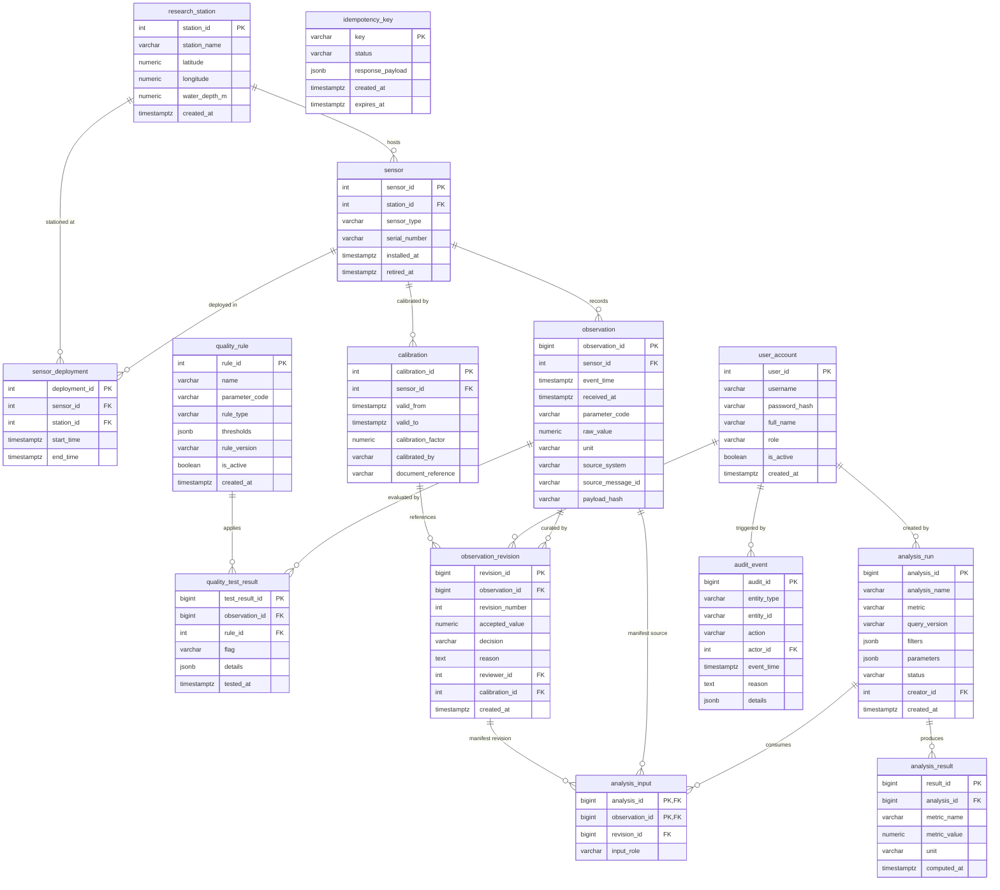

# TideTrace: Relational Database Design Specification

**Document Version:** 1.0.0  
**Project:** TideTrace — Provenance-Aware Ocean Data Integrity and Anomaly Investigation System  
**Engine:** PostgreSQL 16+  
**Status:** Approved Architectural Baseline  

---

## 1. Entity-Relationship Model (Mermaid Diagram)



---

## 2. Relational Schema & Table Definitions

### 2.1 Research Stations & Sensors
```sql
CREATE TABLE research_station (
    station_id SERIAL PRIMARY KEY,
    station_name VARCHAR(120) NOT NULL,
    latitude NUMERIC(8, 5) NOT NULL CHECK (latitude >= -90.0 AND latitude <= 90.0),
    longitude NUMERIC(8, 5) NOT NULL CHECK (longitude >= -180.0 AND longitude <= 180.0),
    water_depth_m NUMERIC(7, 2) CHECK (water_depth_m >= 0.0),
    created_at TIMESTAMPTZ NOT NULL DEFAULT (NOW() AT TIME ZONE 'UTC')
);

CREATE TABLE sensor (
    sensor_id SERIAL PRIMARY KEY,
    station_id INTEGER NOT NULL REFERENCES research_station(station_id) ON DELETE RESTRICT,
    sensor_type VARCHAR(64) NOT NULL,
    serial_number VARCHAR(128) NOT NULL UNIQUE,
    installed_at TIMESTAMPTZ NOT NULL,
    retired_at TIMESTAMPTZ,
    CONSTRAINT chk_sensor_dates CHECK (retired_at IS NULL OR retired_at >= installed_at)
);

CREATE TABLE sensor_deployment (
    deployment_id SERIAL PRIMARY KEY,
    sensor_id INTEGER NOT NULL REFERENCES sensor(sensor_id) ON DELETE RESTRICT,
    station_id INTEGER NOT NULL REFERENCES research_station(station_id) ON DELETE RESTRICT,
    start_time TIMESTAMPTZ NOT NULL,
    end_time TIMESTAMPTZ,
    CONSTRAINT chk_deployment_time CHECK (end_time IS NULL OR end_time >= start_time)
);

CREATE TABLE calibration (
    calibration_id SERIAL PRIMARY KEY,
    sensor_id INTEGER NOT NULL REFERENCES sensor(sensor_id) ON DELETE RESTRICT,
    valid_from TIMESTAMPTZ NOT NULL,
    valid_to TIMESTAMPTZ NOT NULL,
    calibration_factor NUMERIC(10, 5) NOT NULL DEFAULT 1.00000,
    calibrated_by VARCHAR(120) NOT NULL,
    document_reference VARCHAR(255),
    CONSTRAINT chk_calibration_dates CHECK (valid_to >= valid_from)
);
```

### 2.2 Users & Authentication
```sql
CREATE TABLE user_account (
    user_id SERIAL PRIMARY KEY,
    username VARCHAR(64) NOT NULL UNIQUE,
    password_hash VARCHAR(255) NOT NULL,
    full_name VARCHAR(120) NOT NULL,
    role VARCHAR(32) NOT NULL CHECK (role IN ('researcher', 'reviewer', 'steward', 'admin')),
    is_active BOOLEAN NOT NULL DEFAULT TRUE,
    created_at TIMESTAMPTZ NOT NULL DEFAULT (NOW() AT TIME ZONE 'UTC')
);
```

### 2.3 Ingestion & Telemetry Observations
```sql
CREATE TABLE idempotency_key (
    key VARCHAR(128) PRIMARY KEY,
    status VARCHAR(32) NOT NULL CHECK (status IN ('processing', 'completed', 'failed')),
    response_payload JSONB,
    created_at TIMESTAMPTZ NOT NULL DEFAULT (NOW() AT TIME ZONE 'UTC'),
    expires_at TIMESTAMPTZ NOT NULL
);

CREATE TABLE observation (
    observation_id BIGSERIAL PRIMARY KEY,
    sensor_id INTEGER NOT NULL REFERENCES sensor(sensor_id) ON DELETE RESTRICT,
    event_time TIMESTAMPTZ NOT NULL,
    received_at TIMESTAMPTZ NOT NULL DEFAULT (NOW() AT TIME ZONE 'UTC'),
    parameter_code VARCHAR(32) NOT NULL CHECK (parameter_code IN ('temperature', 'salinity', 'ph', 'dissolved_oxygen')),
    raw_value NUMERIC(12, 4) NOT NULL,
    unit VARCHAR(32) NOT NULL,
    source_system VARCHAR(64) NOT NULL,
    source_message_id VARCHAR(128) NOT NULL,
    payload_hash VARCHAR(64),
    -- Record-level deduplication:
    CONSTRAINT uq_observation_source_message UNIQUE (source_system, source_message_id)
);
```

### 2.4 Quality Control Engine
```sql
CREATE TABLE quality_rule (
    rule_id SERIAL PRIMARY KEY,
    name VARCHAR(120) NOT NULL,
    parameter_code VARCHAR(32) NOT NULL CHECK (parameter_code IN ('temperature', 'salinity', 'ph', 'dissolved_oxygen')),
    rule_type VARCHAR(32) NOT NULL CHECK (rule_type IN ('range', 'gap', 'rate_of_change', 'stuck_sensor', 'duplicate')),
    thresholds JSONB NOT NULL,
    rule_version VARCHAR(32) NOT NULL,
    is_active BOOLEAN NOT NULL DEFAULT TRUE,
    created_at TIMESTAMPTZ NOT NULL DEFAULT (NOW() AT TIME ZONE 'UTC'),
    CONSTRAINT uq_rule_version UNIQUE (name, rule_version)
);

CREATE TABLE quality_test_result (
    test_result_id BIGSERIAL PRIMARY KEY,
    observation_id BIGINT NOT NULL REFERENCES observation(observation_id) ON DELETE CASCADE,
    rule_id INTEGER NOT NULL REFERENCES quality_rule(rule_id) ON DELETE RESTRICT,
    flag VARCHAR(16) NOT NULL CHECK (flag IN ('pass', 'suspect', 'fail')),
    details JSONB NOT NULL DEFAULT '{}'::jsonb,
    tested_at TIMESTAMPTZ NOT NULL DEFAULT (NOW() AT TIME ZONE 'UTC')
);
```

### 2.5 Curation & Append-Only Measurement Revisions
```sql
CREATE TABLE observation_revision (
    revision_id BIGSERIAL PRIMARY KEY,
    observation_id BIGINT NOT NULL REFERENCES observation(observation_id) ON DELETE RESTRICT,
    revision_number INTEGER NOT NULL CHECK (revision_number >= 1),
    accepted_value NUMERIC(12, 4) NOT NULL,
    decision VARCHAR(32) NOT NULL CHECK (decision IN ('accepted', 'corrected', 'rejected', 'needs_review')),
    reason TEXT NOT NULL CHECK (LENGTH(reason) >= 5),
    reviewer_id INTEGER NOT NULL REFERENCES user_account(user_id) ON DELETE RESTRICT,
    calibration_id INTEGER REFERENCES calibration(calibration_id) ON DELETE SET NULL,
    created_at TIMESTAMPTZ NOT NULL DEFAULT (NOW() AT TIME ZONE 'UTC'),
    -- Concurrency & ordering integrity:
    CONSTRAINT uq_observation_revision_number UNIQUE (observation_id, revision_number)
);
```

### 2.6 Reproducible Analyses & Input Manifests
```sql
CREATE TABLE analysis_run (
    analysis_id BIGSERIAL PRIMARY KEY,
    analysis_name VARCHAR(255) NOT NULL,
    metric VARCHAR(32) NOT NULL CHECK (metric IN ('mean', 'min', 'max', 'count', 'median', 'standard_deviation')),
    query_version VARCHAR(64) NOT NULL,
    filters JSONB NOT NULL,
    parameters JSONB NOT NULL DEFAULT '{}'::jsonb,
    status VARCHAR(32) NOT NULL CHECK (status IN ('pending', 'running', 'completed', 'failed')),
    creator_id INTEGER NOT NULL REFERENCES user_account(user_id) ON DELETE RESTRICT,
    created_at TIMESTAMPTZ NOT NULL DEFAULT (NOW() AT TIME ZONE 'UTC')
);

CREATE TABLE analysis_input (
    analysis_id BIGINT NOT NULL REFERENCES analysis_run(analysis_id) ON DELETE CASCADE,
    observation_id BIGINT NOT NULL,
    revision_id BIGINT,
    input_role VARCHAR(32) NOT NULL DEFAULT 'primary',
    PRIMARY KEY (analysis_id, observation_id),
    -- Ensure input revision matches observation:
    CONSTRAINT fk_analysis_input_observation FOREIGN KEY (observation_id)
        REFERENCES observation(observation_id) ON DELETE RESTRICT,
    CONSTRAINT fk_analysis_input_revision FOREIGN KEY (revision_id)
        REFERENCES observation_revision(revision_id) ON DELETE RESTRICT
);

CREATE TABLE analysis_result (
    result_id BIGSERIAL PRIMARY KEY,
    analysis_id BIGINT NOT NULL REFERENCES analysis_run(analysis_id) ON DELETE CASCADE,
    metric_name VARCHAR(64) NOT NULL,
    metric_value NUMERIC(16, 6) NOT NULL,
    unit VARCHAR(32) NOT NULL,
    computed_at TIMESTAMPTZ NOT NULL DEFAULT (NOW() AT TIME ZONE 'UTC')
);
```

### 2.7 Audit Events
```sql
CREATE TABLE audit_event (
    audit_id BIGSERIAL PRIMARY KEY,
    entity_type VARCHAR(64) NOT NULL,
    entity_id VARCHAR(64) NOT NULL,
    action VARCHAR(64) NOT NULL,
    actor_id INTEGER REFERENCES user_account(user_id) ON DELETE SET NULL,
    event_time TIMESTAMPTZ NOT NULL DEFAULT (NOW() AT TIME ZONE 'UTC'),
    reason TEXT,
    details JSONB NOT NULL DEFAULT '{}'::jsonb
);
```

---

## 3. Indexing Strategy & Benchmark Plan

### 3.1 Production Indexes
```sql
-- 1. Accelerates observation time-series queries by sensor:
CREATE INDEX idx_observation_sensor_time 
ON observation (sensor_id, event_time DESC);

-- 2. Accelerates observation analysis and parameter aggregation:
CREATE INDEX idx_observation_parameter_time 
ON observation (parameter_code, event_time DESC);

-- 3. Optimizes latest quality results retrieval per observation:
CREATE INDEX idx_quality_result_observation_tested 
ON quality_test_result (observation_id, tested_at DESC);

-- 4. Optimizes revision lookup by observation:
CREATE INDEX idx_observation_revision_obs_rev 
ON observation_revision (observation_id, revision_number DESC);

-- 5. Accelerates reverse manifest checks on revisions:
CREATE INDEX idx_analysis_input_revision 
ON analysis_input (revision_id);

-- 6. Audit trail multi-dimensional searches:
CREATE INDEX idx_audit_event_lookup 
ON audit_event (entity_type, entity_id, event_time DESC);
```

### 3.2 Benchmark Plan (FR-09 / Acceptance Test 8)

The system includes a dedicated benchmark suite (`benchmarks/run_benchmarks.py`) profiling execution plans on 100,000+ synthetic observation rows.

**Target Benchmark Query:**
```sql
EXPLAIN (ANALYZE, BUFFERS, FORMAT JSON)
SELECT parameter_code, AVG(raw_value) AS avg_value, COUNT(*) AS sample_count
FROM observation
WHERE parameter_code = 'temperature'
  AND event_time >= NOW() - INTERVAL '30 days'
GROUP BY parameter_code;
```

**Measured Evidence Criteria:**
1. **Unindexed Baseline:** Measures execution time, total cost, and Shared Hit / Read blocks during a Sequential Scan across 100,000+ rows.
2. **Indexed Optimization:** Measures execution time, cost reduction, and buffer efficiency during a Bitmap Index Scan / Index Scan via `idx_observation_parameter_time`.
3. **Artifact Generation:** Output is persisted to `benchmarks/benchmark_results.json` and presented in UI Screen 3 (Reproducibility & Performance Lab).
